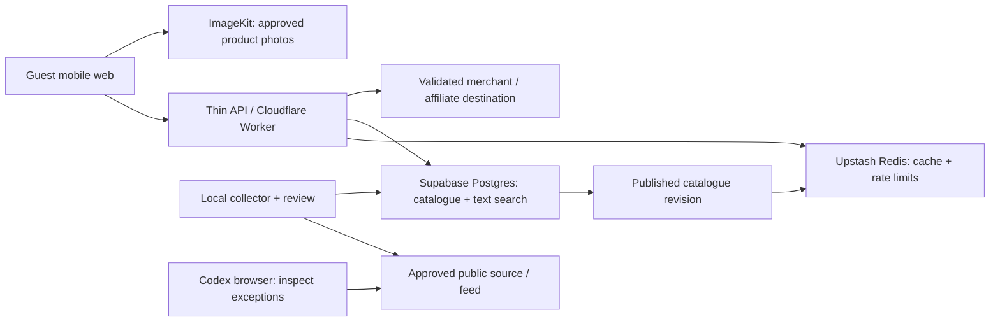

# System design

## Components

## Responsibilities

The React/Vite client handles input, chips, compare selection, local shortlists, image lazy-loading and rendering. A thin Worker normalises input, applies limits, orchestrates Postgres search, reads/writes Redis and signs allowed image destinations. Keep heavy parsing and scraping outside request-serving Workers; the free CPU budget is small. No per-keystroke API search: submit or debounce with a minimum stable input, cancel superseded requests, and provide a cache-friendly canonical request.

Supabase Postgres owns all durable records and the eligibility/ranking query. It also owns import leases and published revisions. Redis may disappear completely without losing products or creating duplicate imports. ImageKit delivers photos only; user reference uploads do not exist in v1.

The local collector handles domain pacing, permitted pagination, normalisation, source snapshots outside the DB, validation and publication. A scheduled local process is optional later and must be shown as dependent on machine uptime. Codex is a development/research interface; its active browser session is not the production scheduler.

## Request path

1. Validate bounded input, parse supported terms, expose ambiguity.
2. Form canonical filters and context; run inexpensive abuse controls.
3. Look up a short-lived Redis result cache using query/rules/revision/context.
4. On miss, run Postgres: hard constraints first, weighted relevance second, stable pagination last.
5. Produce 3–5 initial cards, source explanations and separately labelled uncertain candidates if requested.
6. Re-evaluate freshness at response time; cached data keeps its original observation times.
7. On compare, load the exact variants; calculate separate one-item merchant totals.
8. On outbound click, validate destination against stored data. Best-effort update if an approved fast checker exists. If it does not, show the original checked time and continue to merchant without a false "verified now" label.

No synchronous cross-brand scrape on every search. No on-demand request may turn arbitrary user URLs into a fetch/proxy.

## Price and confidence boundaries

Store product price, shipping, COD fee, discount eligibility and quote status separately. A quote has a context fingerprint: variant, quantity=1, country/pincode context where available, payment mode, customer status and selected promotion. A mix of unknown and known terms cannot produce a confirmed delivered total.

Known cost excluding delivery may be shown as a subtotal. For delivered-budget mode, it belongs outside the confirmed budget group until delivery is known. Switching to item-price budget is a user action.

Confidence is field-specific. A well-supported racing theme does not validate a refund policy or price. "Fresh source observation" does not mean a merchant guarantee.

## Publication and consistency

For each store run, stage normalised changes under an import_run_id, review anomalies, then publish through a controlled database transaction. Keep old records readable until the new revision commits. Publish a durable catalogue revision and an invalidation/outbox record in the same transaction. Redis updates are best effort after commit. A failed cache update must not roll back a correct catalogue publish.

When a source is partly readable, publish trustworthy observed updates only with an explicit partial flag and no absence/removal inference. Do not mark stale records freshly checked just because a partial run finished.

## Failure behaviour

| Failure | Response |
|---|---|
| Redis timeout/quota | Skip cache, serve bounded Postgres reads; local soft limits and edge controls still apply. Protect expensive/administrative operations separately. |
| Postgres unavailable/paused | Show a clear temporary-unavailable state. An existing cached snapshot may appear with its original time and live-check unavailable; never silently label it current. |
| ImageKit limit/error | Show a proper placeholder. Original merchant image fallback only if rights and integration allow; avoid unbounded retries. |
| One brand fails | Preserve its previous checked data with freshness state; other brands remain usable. |
| Policy conflict | Explain unknown/conflicting terms and do not let that product pass a strict return filter. |
| Affiliate paused | Use an ordinary merchant link; do not invent commission eligibility. |

## Scaling from 10 to 40

Use registry-driven adapters, not conditional code keyed to brand names. Reuse the Shopify adapter for compatible stores; add rendered-page/feed adapters by capability. Keep category/theme dictionaries independent from source-specific field mappings. Measure DB query plans, importer coverage, storage, Redis command count and image bandwidth before adding services or paid tiers.
